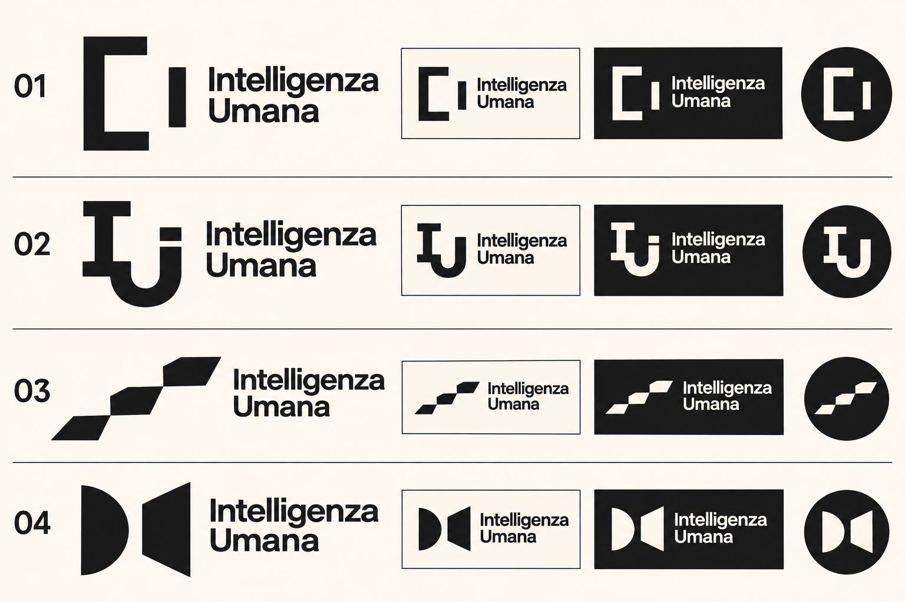

# Intelligenza Umana — Logo 02
## Concept: IU monogram
The compact geometric mark combines I and U. The I has horizontal terminals intertwined with the U; a gap separates the upper right stroke. The full Italian name accompanies it in a simple two-line sans-serif wordmark. It conveys authority, accessibility and human thought without stereotypical brains or circuits.
## Visual reference

The second row shows the standalone mark, full light-background logo, inverted dark version and circular preview.
## Characteristics
- Compact IU monogram with a gap in the U.
- Name: Intelligenza Umana.
- Minimal, contemporary, editorial style.
- Charcoal and ivory; intended to work in monochrome.
- Applications: website, documents, presentations, software, profiles and print.
## Status and next steps
Preliminary visual proposal, not a production vector master. Reconstruct geometry, strokes and spacing; define typography and proportions; test 32 px and circular crop; prepare monochrome/light/dark variants; check similarities and prior marks before definitive use or registration.
